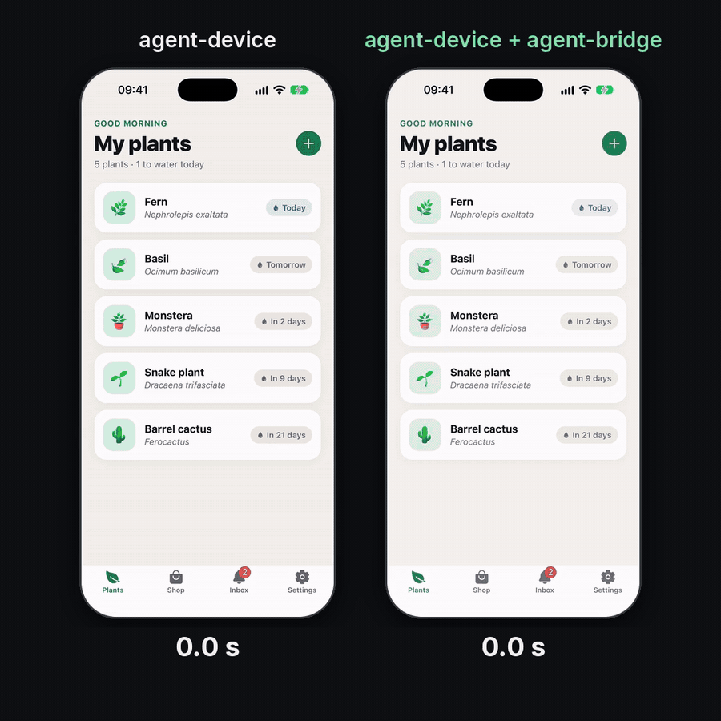

# @avasapp/agent-bridge

Let coding agents drive any running Expo or React Native app directly. Seed data, flip flags, fake realtime messages, navigate and check the screen in **milliseconds**, without tapping through the app. It works alongside device tools such as [agent-device](https://github.com/callstack/agent-device) and [Argent](https://github.com/software-mansion/argent): they open the app and handle native UI, and agent-bridge handles everything inside the app. Use it from a shell, from [flows](docs/cli.md) or as an [MCP server](docs/cli.md#mcp-server).



The same 19 checks on [the example app](example), at real speed: 22.4 s with agent-device alone, 1.4 s with agent-bridge. Most calls take a few milliseconds ([benchmarks](docs/benchmarks.md)).

Works on Expo (dev-tools socket) and on bare React Native (CDP over Metro). Nothing ships to users: every entry point compiles to an empty stub in release builds, and `agent-bridge assert-absent` checks a bundle in CI ([security](docs/security.md)).

## Install

```sh
npx @avasapp/agent-bridge init
```

Run it in the app. It installs the package, writes a dev-only `src/dev/agent-bridge.tsx` wired for the libraries it finds, adds a smoke flow and the agent skill, and prints the two lines to paste into your root component. Agents run it as `init --json`; see [the CLI](docs/cli.md#init).

### Manual setup

```sh
bun add -d @avasapp/agent-bridge   # or npm / yarn / pnpm
```

The package ships an agent skill that tells your agent when and how to drive the app. Add it to Claude Code, Cursor, Codex and other agents:

```sh
npx skills add avas-app/agent-bridge
```

In Claude Code you can install it as a plugin instead:

```
/plugin marketplace add avas-app/agent-bridge
/plugin install agent-bridge@agent-bridge
```

## In the app

Mount the hook in a file that only runs in development. You choose every tool; [adapters](docs/adapters.md) for common libraries are one import away.

```tsx
import { cdpTransport, useAgentBridge } from '@avasapp/agent-bridge'
import { expoTransport } from '@avasapp/agent-bridge/expo'
import { queryTools } from '@avasapp/agent-bridge/tanstack-query'
import { storeTools } from '@avasapp/agent-bridge/zustand'
import { mmkvTools } from '@avasapp/agent-bridge/react-native-mmkv'
// import { asyncStorageTools } from '@avasapp/agent-bridge/async-storage'
// import { secureStoreTools } from '@avasapp/agent-bridge/secure-store'
// import { reduxTools } from '@avasapp/agent-bridge/redux'
// import { jotaiTools } from '@avasapp/agent-bridge/jotai'
import { routerTools } from '@avasapp/agent-bridge/expo-router'
import { networkTools } from '@avasapp/agent-bridge/network'
import { router, useNavigationContainerRef } from 'expo-router'

export function AgentBridge() {
  const queryClient = useQueryClient()
  useAgentBridge({
    name: 'my-app',
    transports: [expoTransport(), cdpTransport()],
    tools: {
      ...queryTools(queryClient),
      ...storeTools(
        { settings: useSettingsStore, auth: useAuthStore },
        // Masks these paths in every store.* output; `store.set` and
        // `store.call` never echo the whole store. An action's return value
        // is matched by store path only if it is a piece of the state itself,
        // not a copy; use a hook function for those.
        { redact: { auth: ['accessToken', 'refreshToken', 'user.phone'] } },
      ),
      ...mmkvTools({ storage }),
      // Redux and Jotai state often holds tokens: add `redact` before wiring them.
      // ...reduxTools(store, { redact: { auth: ['token'] } }),
      // ...jotaiTools(getDefaultStore(), { user: userAtom }),
      // AsyncStorage and SecureStore often hold tokens: wire them only if you accept that.
      // ...asyncStorageTools(AsyncStorage),
      // ...secureStoreTools(SecureStore, ['authToken'], { keychainService: 'auth' }),
      ...routerTools(router, { navigation: useNavigationContainerRef() }),
      ...networkTools(),
      // Your own tools: any function, JSON in and out.
      'auth.signIn': (session) => signInWith(session),
    },
  })
  return null
}
```

Every app also gets `screen.snapshot` (one short line per element), `screen.press` (taps, long presses, Switch toggles), `screen.fill`, `screen.setValue` (Switch, Slider, Picker, SegmentedControl), `screen.scroll`, `screen.waitFor`, `screen.findText`, `app.reload`, and `bridge.restore` to undo everything the agent changed, even across a reload in a session. See [built-in tools and restore](docs/built-in-tools.md), including how to give agents your own hooks and register their undo.

Most flows need the app in a known state first, such as a user signed in locally with every request mocked. Define that once as a [scenario](docs/scenarios.md).

## From the agent

```sh
npx @avasapp/agent-bridge session start            # hold one connection; call/tools/run reuse it
npx @avasapp/agent-bridge tools
npx @avasapp/agent-bridge call scenario.apply '["signedIn", {"user": {"name": "Ada"}}]'
npx @avasapp/agent-bridge call query.pin '[["features"], {"beta": false}]'
npx @avasapp/agent-bridge call screen.press '"add-plant"'
npx @avasapp/agent-bridge call screen.waitFor '"Name is required"'
npx @avasapp/agent-bridge run flows/add-plant.flow.mjs --strict   # fail if the app logged an error
npx @avasapp/agent-bridge run flows/ --bail                        # every *.flow.mjs in order, restore after each
npx @avasapp/agent-bridge session stop             # runs bridge.restore, then disconnects
```

Agents should run `./node_modules/.bin/agent-bridge` rather than `npx`, which is slower and can print npm warnings into their output. See [the CLI](docs/cli.md) for flows, batch mode, the REPL, sessions and the `connect()` client. Agents that prefer MCP tools to a shell can run `agent-bridge mcp`; see [the MCP server](docs/cli.md#mcp-server).

No device tool is needed. Pair one (such as agent-device or Argent) with the bridge for what it can't reach: system alerts, permission prompts, the keyboard, screenshots, and one real tap per flow. On bare React Native the bridge talks over Metro's debugger socket, which React Native before 0.85 gives to one client at a time, so a tool that holds the debugger open (Argent's debugger tools, React Native DevTools) and the bridge take it from each other; Expo apps use the dev-tools socket and are not affected.

The screen tools measure with Fabric, so they need React Native's New Architecture; on the old one the tools that need positions fail with an error that says so (`snapshot {all: true}` and `findText` still return text, without rects).

## Docs

- [Built-in tools and restore](docs/built-in-tools.md)
- [The CLI, flows and the client](docs/cli.md)
- [Scenarios](docs/scenarios.md): signed-in state, strict network, fixtures, gates
- [Adapters](docs/adapters.md): TanStack Query, Zustand, Redux, Jotai, MMKV, AsyncStorage, SecureStore, Expo Router, React Navigation, network
- [WebViews](docs/webviews.md)
- [Realtime](docs/realtime.md): Ably, socket.io, any other library
- [Device events](docs/device-events.md): deep links, app state, offline, push notifications, the clock
- [Security and release builds](docs/security.md)
- [Benchmarks](docs/benchmarks.md)

## Contributing

See [CONTRIBUTING.md](CONTRIBUTING.md).

## License

MIT © Avas Enterprises
